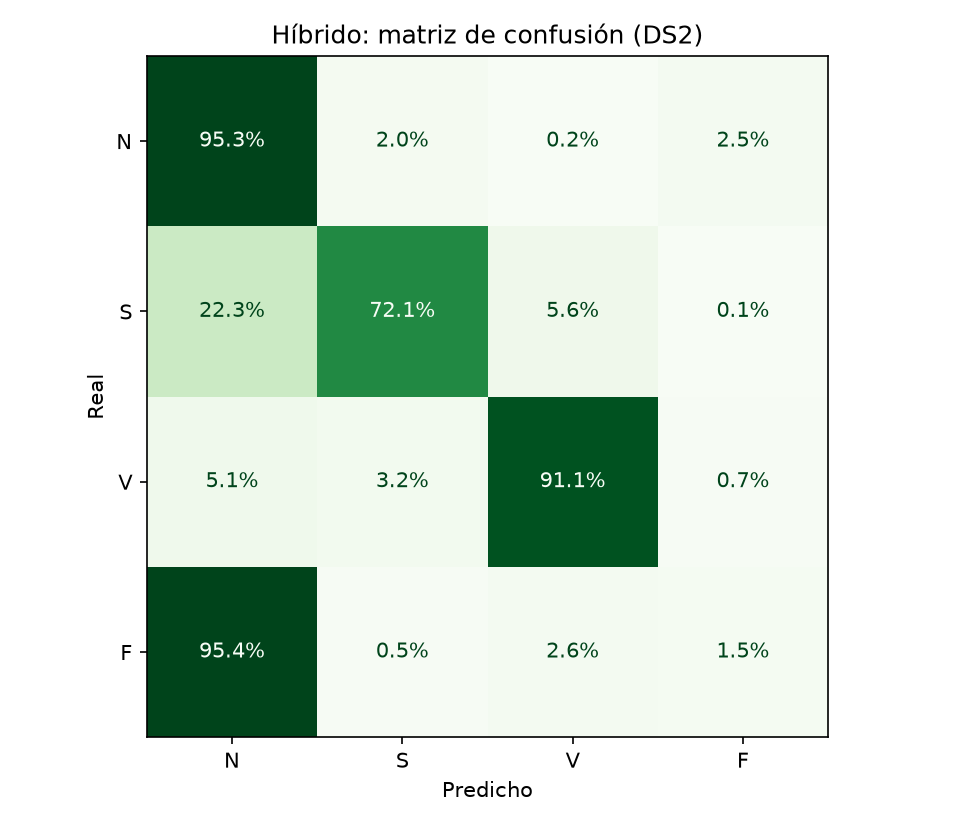
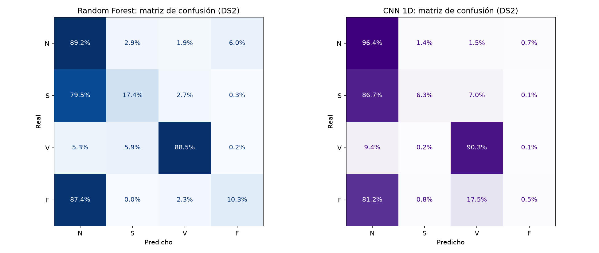

# Detector de arritmias con ECG e inteligencia artificial

Clasificador de latidos del corazón a partir del electrocardiograma (ECG), entrenado y evaluado con la base de datos clínica **MIT-BIH Arrhythmia**. El mejor modelo detecta el **91,1 % de los latidos ventriculares** y el **72,1 % de los supraventriculares** en pacientes que no ha visto durante el entrenamiento.

Proyecto personal de Diego Corrales Obregón, estudiante de 2.º de Ingeniería Biomédica.

> **Aviso:** este es un proyecto educativo y de investigación. No es un dispositivo médico y no debe usarse para diagnosticar.

## Resultados

Sensibilidad por clase en 22 pacientes de prueba, distintos de los 22 de entrenamiento:

| Clase | Random Forest | CNN 1D | **Híbrido** |
|---|---|---|---|
| N (normal) | 89,2 % | 96,4 % | **95,3 %** |
| S (supraventricular) | 17,4 % | 6,3 % | **72,1 %** |
| V (ventricular) | 88,5 % | 90,3 % | **91,1 %** |
| F (fusión) | 10,3 % | 0,5 % | 1,5 % |
| Accuracy | 85,9 % | 92,0 % | **93,4 %** |

Cuando el modelo híbrido marca un latido como ventricular, acierta el 93,9 % de las veces. En los otros dos modelos esa cifra es del 76–77 %.





## Cómo funciona

1. **Filtrado.** Filtro paso banda Butterworth de 0,5 a 40 Hz, de fase cero. Elimina la deriva de la línea base, el ruido muscular y la interferencia de la red eléctrica.
2. **Detección de latidos.** Versión simplificada del algoritmo de Pan-Tompkins: derivada, cuadrado, media móvil de 150 ms y umbral.
3. **Características.** Intervalos RR normalizados por paciente, anchura del QRS, amplitudes de las ondas y energía del complejo QRS.
4. **Clasificación** en las clases AAMI (N, S, V, F) con tres modelos:
   - **Random Forest**, con las características anteriores.
   - **CNN 1D**, que aprende de la forma de onda (650 ms alrededor del pico R).
   - **Híbrido**, una red con dos ramas: una convolucional para la forma y otra para el ritmo.

## Una evaluación honesta

Los modelos se entrenan con 22 pacientes (DS1) y se prueban con otros 22 distintos (DS2), siguiendo la división de de Chazal et al. (2004). Se excluyen los 4 registros con marcapasos, como recomienda el estándar AAMI EC57.

Esta decisión cambia mucho los números. Con el mismo Random Forest:

| | División aleatoria de latidos | División entre pacientes |
|---|---|---|
| Accuracy | 97,8 % | 85,9 % |
| Sensibilidad S | 90,8 % | 17,4 % |

Si se mezclan latidos del mismo paciente en entrenamiento y prueba, el modelo reconoce al paciente y el resultado no refleja cómo funcionaría con una persona nueva.

## Lo que he aprendido de los datos

- **Las clases están muy desequilibradas.** El 83 % de los latidos son normales. Un clasificador que respondiera siempre "normal" acertaría el 83 % y no detectaría ninguna arritmia. Por eso la métrica principal es la sensibilidad por clase y no el accuracy.
- **Un solo paciente domina la clase S.** El registro 232 aporta 1381 de los 1836 latidos S de prueba (75 %). El Random Forest solo detecta el 1 % de ellos; sin ese paciente, su sensibilidad en S pasa del 17,4 % al 67,0 %. El modelo híbrido resuelve la mayor parte de este caso.
- **Cada modelo falla en pacientes distintos.** La CNN pierde rendimiento en registros ruidosos y el Random Forest en pacientes con morfologías atípicas.

### Detector de latidos

Evaluado en 6 registros (14 530 latidos) contra las anotaciones de los cardiólogos:

| Umbral | Sensibilidad | Predictividad positiva |
|---|---|---|
| 0,30 | 90,1 % | 99,0 % |
| **0,15** | **98,5 %** | **98,3 %** |

Para entrenar los clasificadores se usan las posiciones anotadas por los cardiólogos, como es habitual en la literatura. Así se mide la clasificación sin mezclarla con los errores de detección.

## Limitaciones

- **Ruido.** En el registro de prueba más ruidoso (105), el híbrido solo detecta el 22 % de los latidos ventriculares.
- **Latidos de fusión (F).** Casi todos los ejemplos de entrenamiento vienen de un único paciente, y ningún modelo generaliza en esta clase.
- **La base de datos.** MIT-BIH se grabó entre 1975 y 1979 en un solo hospital, con 47 pacientes. Es la referencia del campo, pero es pequeña y antigua.
- **Marcapasos.** El sistema no está pensado para personas con marcapasos.

## Cómo reproducirlo

Requiere Python 3.12 o superior.

```bash
python -m venv .venv
.venv\Scripts\activate          # En Windows
pip install -r requirements.txt
```

Ejecuta los scripts en orden. La primera vez, `dia3.py` descarga la base de datos (unos 100 MB) desde PhysioNet.

| Script | Qué hace |
|---|---|
| `dia1.py` | Lee un registro y dibuja el ECG con sus anotaciones |
| `dia2.py` | Cuenta los latidos por clase AAMI |
| `dia3.py` | Descarga la base y aplica el filtro |
| `dia4.py` | Detecta los picos R y evalúa el detector |
| `dia5.py` | Extrae las características de cada latido |
| `dia6.py` | Random Forest, con división aleatoria y entre pacientes |
| `dia7.py` | CNN 1D sobre la forma de onda |
| `dia8.py` | Comparación de modelos y análisis por paciente |
| `dia9.py` | Modelo híbrido (forma y ritmo) |

`preprocesado.py` contiene las funciones de filtrado y detección que usan los demás scripts.

## Siguiente fase

Construir un ECG portátil con Arduino y un módulo AD8232 que registre la señal y la clasifique en tiempo real con el modelo híbrido.

## Referencias

- Moody GB, Mark RG. *The impact of the MIT-BIH Arrhythmia Database.* IEEE Engineering in Medicine and Biology Magazine, 2001.
- Goldberger AL et al. *PhysioBank, PhysioToolkit, and PhysioNet.* Circulation, 2000.
- de Chazal P, O'Dwyer M, Reilly RB. *Automatic classification of heartbeats using ECG morphology and heartbeat interval features.* IEEE Transactions on Biomedical Engineering, 2004.
- Pan J, Tompkins WJ. *A real-time QRS detection algorithm.* IEEE Transactions on Biomedical Engineering, 1985.
- ANSI/AAMI EC57. *Testing and reporting performance results of cardiac rhythm and ST segment measurement algorithms.*

Los datos proceden de [PhysioNet](https://physionet.org/content/mitdb/) y no se incluyen en este repositorio.
